

<picture><source media="(prefers-color-scheme: dark)" srcset="assets/hero-dark.svg"></picture>

<picture><source media="(prefers-color-scheme: dark)" srcset="assets/social-l-dark.svg"></picture><a href="https://t.me/Gplay666"><picture><source media="(prefers-color-scheme: dark)" srcset="assets/social-1-dark.svg"></picture></a><a href="https://discord.gg/vdU5E5VYQh"><picture><source media="(prefers-color-scheme: dark)" srcset="assets/social-2-dark.svg"></picture></a><a href="https://gplaydev.ru/"><picture><source media="(prefers-color-scheme: dark)" srcset="assets/social-3-dark.svg"></picture></a><picture><source media="(prefers-color-scheme: dark)" srcset="assets/social-r-dark.svg"></picture>

<picture><source media="(prefers-color-scheme: dark)" srcset="assets/about-dark.svg"></picture>

<picture><source media="(prefers-color-scheme: dark)" srcset="assets/stack-dark.svg"></picture>

<a href="https://github.com/Gplay666/TaskManager"><picture><source media="(prefers-color-scheme: dark)" srcset="assets/project-taskmanager-dark.svg"></picture></a>&nbsp;<a href="https://github.com/Gplay666/GSimpleDiceRandomiser"><picture><source media="(prefers-color-scheme: dark)" srcset="assets/project-gsimpledicerandomiser-dark.svg"></picture></a>

<a href="https://github.com/Gplay666/miku-desktop-mascot-trend-hyprland"><picture><source media="(prefers-color-scheme: dark)" srcset="assets/project-miku-desktop-mascot-trend-hyprland-dark.svg"></picture></a>&nbsp;<a href="https://github.com/Gplay666/ResumeSite"><picture><source media="(prefers-color-scheme: dark)" srcset="assets/project-resumesite-dark.svg"></picture></a>

<picture><source media="(prefers-color-scheme: dark)" srcset="assets/stats-dark.svg"></picture>

<picture><source media="(prefers-color-scheme: dark)" srcset="assets/streak-dark.svg"></picture>

<picture><source media="(prefers-color-scheme: dark)" srcset="assets/wave-dark.svg"></picture>

<a href="https://gplaydev.ru/"><picture><source media="(prefers-color-scheme: dark)" srcset="assets/button-1-dark.svg"></picture></a>&nbsp;&nbsp;<a href="https://github.com/Gplay666?tab=repositories"><picture><source media="(prefers-color-scheme: dark)" srcset="assets/button-2-dark.svg"></picture></a>

<a href="https://metawka.github.io/expressive-profile/?from=Gplay666"><picture><source media="(prefers-color-scheme: dark)" srcset="assets/credit-dark.svg"></picture></a>

